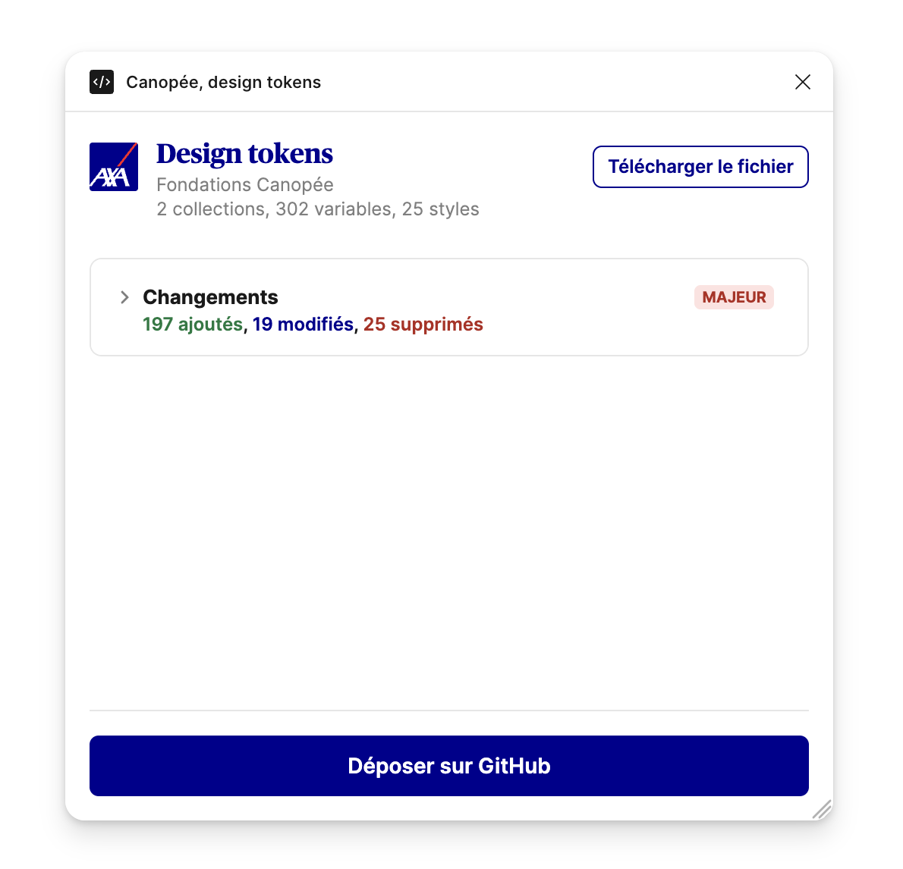
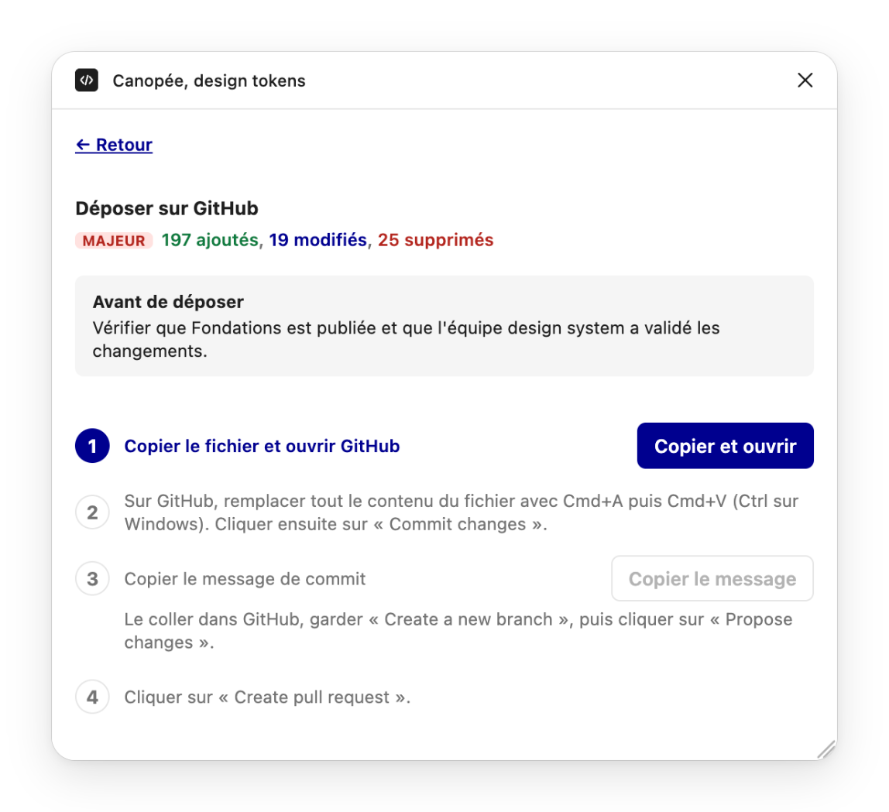
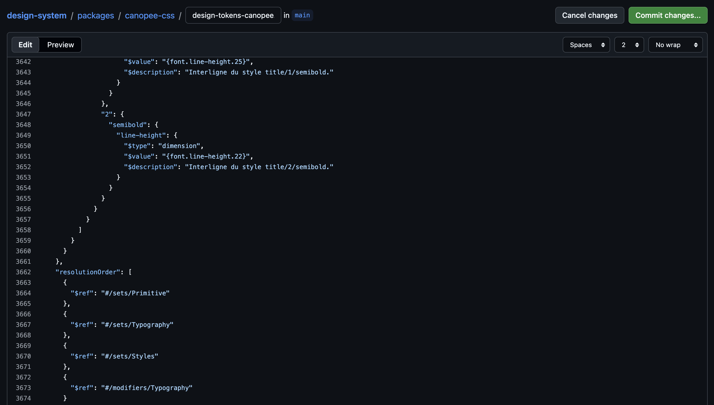
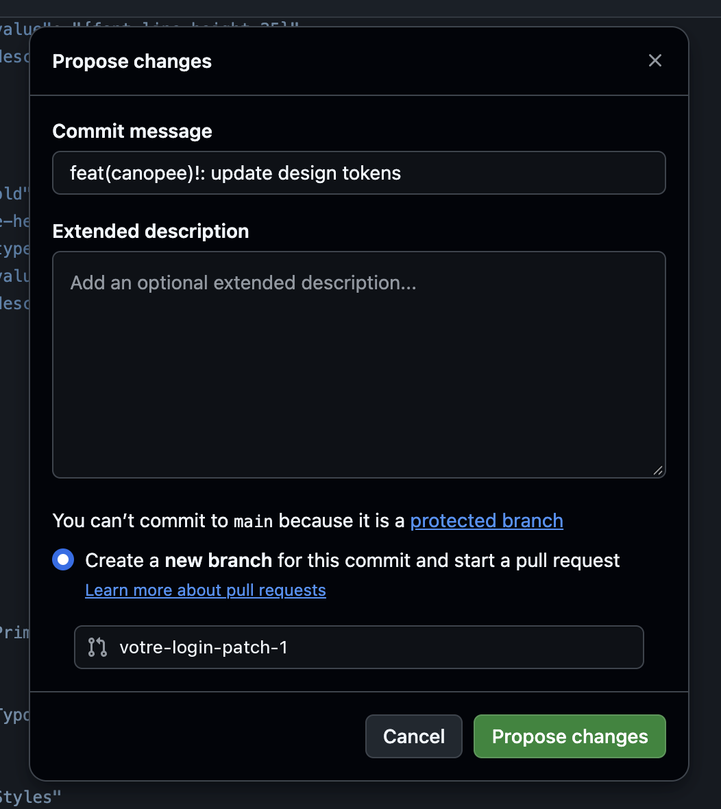
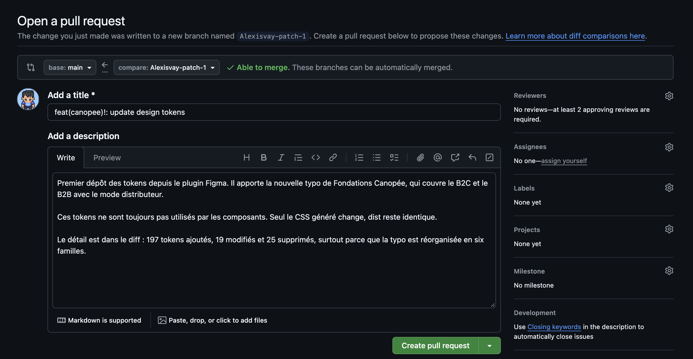
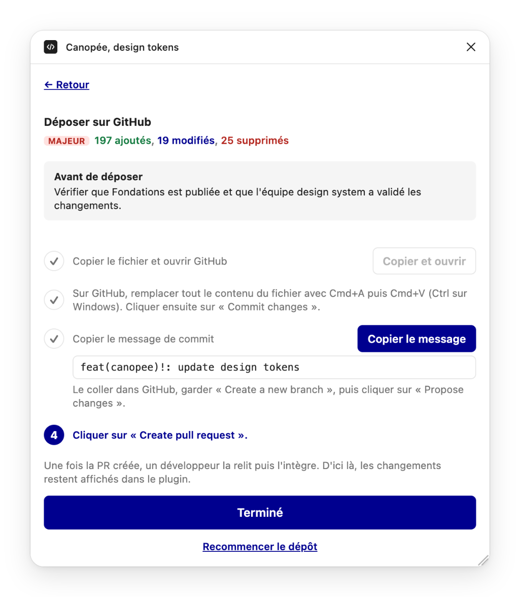

# Créer ou modifier un token

Un design token se crée une seule fois, dans la librairie Figma Fondations Canopée. Ensuite, il passe dans le code sans être ressaisi. Figma et le code ont donc toujours les mêmes valeurs. Ce processus est le même pour le B2C et le B2B.

> [!IMPORTANT]
> Seule l'équipe design system peut créer, modifier ou supprimer un token. Un designer ou un développeur qui a besoin d'un token le demande à l'équipe, comme expliqué à l'étape 1.

```
Figma  →  plugin Canopée  →  fichier JSON  →  PR sur GitHub  →  variables CSS
```

Le plugin Canopée transforme les tokens de Figma en fichier JSON. Ce fichier est envoyé sur GitHub dans une PR, c'est-à-dire une demande de modification. Les développeurs la relisent, puis l'acceptent. Ensuite, un outil appelé Terrazzo crée les variables CSS à partir du fichier.

## Les étapes

| Étape | Qui | Outil |
|---|---|---|
| 1. Remonter le besoin | Tout designer ou développeur | Instance design system ou Teams |
| 2. Modifier les tokens | Équipe design system | Figma, plugin Canopée |
| 3. Publier et valider dans Figma | Équipe design system | Figma |
| 4. Déposer sur GitHub | Équipe design system | GitHub, plugin Canopée |
| 5. Relire et intégrer | Développeurs de Canopée | GitHub |
| 6. Générer le CSS | Automatique | Terrazzo |
| 7. Publier une version | Développeurs de Canopée | Package CSS de Canopée |

### 1. Remonter le besoin

Il manque un token, ou une valeur ne convient plus ? Il suffit de le signaler en instance design system, ou sur Teams, dans le canal Aide et demande B2C ou B2B de l'équipe Canopée. L'équipe design system étudie la demande et s'occupe de la suite.

### 2. Modifier les tokens

L'équipe design system crée et modifie les tokens uniquement dans le fichier Figma Fondations Canopée. Les librairies de composants B2C et B2B utilisent exclusivement ces tokens.

Un token sémantique porte un nom qui dit son usage, comme icon/size/small. Sa valeur pointe vers une primitive, une valeur brute comme size/24. L'équipe design system range chaque token sémantique dans une collection, selon ce qui fait changer la valeur du token.

La collection Typography change selon le B2C ou le B2B, le thème et l'écran. Elle a un jeu de valeurs, appelé mode, pour chaque combinaison, soit cinq en tout. La collection Size garde les mêmes valeurs partout et n'a qu'un mode. Pour des couleurs qui changent selon le thème, l'équipe créerait une collection Color, avec un mode par thème.

Avant de publier, vérifier dans le plugin Canopée qu'il n'y a pas d'erreur.

### 3. Publier et valider dans Figma

L'équipe design system :

1. Publie la librairie Fondations Canopée.
2. Teste les changements dans les fichiers qui utilisent la librairie.
3. Valide l'ensemble des changements en équipe.

Cette étape est indispensable. Rien ne part chez les développeurs sans avoir été testé et validé dans Figma.

Le dépôt peut se faire plus tard, pas forcément juste après la publication. Attention, le dépôt envoie l'état complet de Fondations Canopée, pas seulement la dernière modification. Si un autre changement est en cours dans le fichier, il part aussi. Tout doit donc être validé avant de déposer.

### 4. Déposer sur GitHub

Pour déposer, il faut un compte GitHub, même personnel. Ceux qui ont les droits d'écriture sur le repo déposent directement. Les autres passent par une copie du repo sur leur compte, appelée fork. GitHub la crée automatiquement au premier dépôt.

Le dépôt fait des allers-retours entre le plugin et GitHub. Le plugin guide chaque étape.

**a. Relire les changements**

Ouvrir le fichier Figma Fondations Canopée et lancer le plugin Canopée. La section Changements résume ce qui part dans la PR. Cliquer sur son titre pour voir le détail : les tokens ajoutés, modifiés, supprimés et dépréciés, avec l'ancienne et la nouvelle valeur.


*Cliquer sur Déposer sur GitHub pour lancer le dépôt.*

Cliquer sur **Déposer sur GitHub**. Le bouton est bloqué s'il reste une erreur à corriger, ou si les tokens sont identiques au code. Il est aussi bloqué tant qu'une PR de tokens est ouverte. Un bandeau bleu, juste au-dessus du bouton, donne alors son lien. Le dépôt redevient possible une fois cette PR intégrée ou fermée.

**b. Suivre le parcours du plugin**

Le plugin affiche le parcours en quatre étapes. Pour une refonte complète des tokens, cocher **Refonte complète** au-dessus des étapes.


*Suivre les quatre étapes dans l'ordre, en commençant par Copier et ouvrir.*

**c. Coller le fichier sur GitHub**

Cliquer sur **Copier et ouvrir**. Le plugin copie le fichier des tokens et ouvre sa page sur GitHub. Sur cette page, cliquer dans le texte, faire Cmd+A puis Cmd+V (Ctrl sur Windows) pour remplacer tout le contenu, puis cliquer sur **Commit changes**.


*Coller le fichier, puis cliquer sur Commit changes.*

**d. Copier le message et créer une branche**

Revenir dans le plugin et cliquer sur **Copier le message**. Ce message décrit le dépôt dans le format que le repo exige, le plugin l'écrit tout seul. Le coller dans le champ **Commit message** de la fenêtre GitHub. Le champ **Extended description** peut rester vide.

GitHub crée une nouvelle branche pour le dépôt : garder ce choix. La branche principale du repo est protégée, rien n'arrive dans le code sans relecture.


*Coller le message du plugin, garder la nouvelle branche, puis cliquer sur Propose changes.*

Cliquer sur **Propose changes**.

**e. Ouvrir la PR**

Sur la page suivante, cliquer sur **Create pull request**. Le titre reprend le message du plugin. La description peut dire en une phrase ce qui change et pourquoi. Cliquer à nouveau sur **Create pull request** : la PR part chez les développeurs.


*Vérifier que la PR vise main (en haut à gauche), puis cliquer sur Create pull request.*

**f. Terminer**

Revenir dans le plugin et cliquer sur **Terminé**. Les changements restent affichés dans le plugin jusqu'à l'intégration de la PR.


*Cliquer sur Terminé pour revenir au plugin.*

### 5. Relire et intégrer

Un développeur de Canopée relit la PR.

Si un changement pose question, le développeur laisse un commentaire dans la PR. L'équipe design system ferme alors la PR, corrige dans Figma, puis dépose à nouveau. Un nouveau dépôt ouvre toujours une nouvelle PR.

> [!WARNING]
> Le fichier des tokens ne se modifie jamais à la main dans GitHub.

Quand tout est bon, le développeur intègre la PR. Au lancement suivant du plugin, la section Changements indique « Aucun changement » et le bouton Déposer sur GitHub est désactivé : Figma et le code sont identiques.

### 6. Générer le CSS

À chaque build de Canopée, Terrazzo crée les variables CSS à partir du fichier des tokens.

> [!WARNING]
> Ce processus est en cours de mise en place. Pour l'instant, les composants utilisent toujours les variables CSS actuelles, pas les nouvelles.

### 7. Publier une version

Les projets reçoivent les nouveaux tokens avec la prochaine version du package CSS de Canopée. Ce sont les développeurs de Canopée qui décident quand elle sort.

Le plugin donne un niveau à chaque dépôt, qui choisit son message de commit.

| Changement | Niveau |
|---|---|
| Une refonte complète des tokens, cochée dans le plugin | Majeur |
| Un ou plusieurs tokens ajoutés, supprimés ou dépréciés, ou dont le type change | Mineur |
| Une ou plusieurs valeurs modifiées | Patch |

Le niveau décrit le changement des tokens. Les développeurs de Canopée décident de la version du package. Cette règle est une proposition, à valider avec les développeurs de Canopée.

## Déprécier un token

Un token qui ne doit plus servir n'est pas supprimé tout de suite. Il est d'abord déprécié, pour laisser aux designers et aux développeurs le temps de le remplacer dans leurs fichiers et leur code. Il est supprimé à la version majeure suivante de Canopée.

### Déprécier

L'équipe design system :

1. Ajoute le mot **Deprecated** au début de la description de la variable. Il est possible de préciser ensuite le ou les tokens à utiliser à la place, ou la raison de la dépréciation, mais ce n'est pas obligatoire. Exemple : « Deprecated: use color/blue/700. »
2. Retire tous les scopes de la variable. Elle n'apparaît plus dans les sélecteurs de Figma, mais les fichiers qui l'utilisent continuent de fonctionner.
3. Dépose le changement sur GitHub avec le plugin, comme décrit à l'étape 4 « Déposer sur GitHub ». Le plugin compte le token comme déprécié, ce qui donne une version mineure.

Quand le token a un remplaçant, sa valeur est souvent reliée à ce nouveau token, sous forme d'alias. Les projets qui ne sont pas encore à jour affichent ainsi déjà la nouvelle valeur. Cette phase de transition dure jusqu'à la version majeure suivante.

La variable ne doit être ni renommée, ni masquée à la publication. Dans le code, elle reste disponible jusqu'à sa suppression.

### Supprimer

Les tokens dépréciés sont supprimés tous ensemble, à la version majeure suivante de Canopée. Les développeurs de Canopée décident quand elle sort. L'équipe design system supprime alors les variables dans Fondations Canopée, puis dépose le changement sur GitHub avec le plugin.

## Installer le plugin

Le plugin Canopée se récupère sous forme de zip, en pièce jointe de la page « Créer ou modifier un token » sur Zeroheight. Il s'installe une seule fois, dans Figma Desktop.

1. Télécharger le zip et le décompresser sur son poste.
2. Dans Figma Desktop, ouvrir le menu **Plugins › Development › Import plugin from manifest**.
3. Choisir le fichier manifest.json du dossier décompressé.

Le plugin apparaît ensuite dans **Plugins › Development**, sous le nom **Canopée, design tokens**. Pour installer une nouvelle version, il suffit de remplacer les fichiers du dossier par ceux du nouveau zip. Figma la charge au prochain lancement du plugin.
